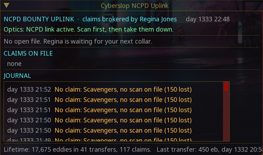

# Bounty Ledger

NCPD street bounties as a warrant system: price by wanted stars, more for bringing targets in alive, and a delayed payout in one batch, with an NCPD Uplink window for the claim file, for Cyberpunk 2077. Single-player only.
Version: Bounty Ledger 1.1.7, NCPD Uplink 1.0.0 | For game version 2.5 | Status: 1.0.0 tested in game on 2.31 (prices, alive claim, death downgrade, scan rule and batching seen; the payout itself was not reached in that test); Bounty Ledger 1.1.7 and NCPD Uplink 1.0.0 in use in my game and working; no written test record

> This is an unofficial fan work and is not approved/endorsed by CD PROJEKT RED. No game files are included.



## The problem

In the base game a street bounty is a reward scaled to the target's level, paid the moment the target dies. Killing is always the best option, the price has nothing to do with how dangerous the target is, and the money arrives with no paperwork at all.

## What I built

Two redscript files (1,378 lines) and a Lua window for the Cyber Engine Tweaks overlay (370 lines). It changes: how much an NCPD street bounty pays, whether the target must be alive, when the money arrives, and what counts as a valid claim. Street Cred and kill XP stay vanilla.

1. **Price by wanted stars.** Every generic NCPD bounty pays the price set for its star count. Named bounties keep their record value.
2. **Alive pays full, dead pays less.** A target knocked out with a non-lethal takedown pays the alive rate (default 100 %); a dead target pays the dead rate (default 50 %). A target claimed alive that dies before the payout drops to the dead rate.
3. **No scan, no claim.** Your optics must have pulled the record (scanner tooltip or a completed scan) before the target went down.
4. **NCPD pays later.** Claims collect into one batch that is paid after the processing time (default 10 game minutes), with the vanilla "Bounty collected" banner and an NCPD message from Regina Jones. Open claims are kept in the save.

With Kiroshi Optics - Deep Scan Protocol installed, scanned civilians with an active warrant become bail jobs: a non-lethal knockout files a claim, killing them pays nothing. Without Deep Scan this part is off.

NCPD Uplink shows the claim file: the open batch with a countdown to the payout, claims on file, warrants seen this game session, a journal of the last 40 events (kept in the save) and lifetime totals. It only reads from the Ledger.

## How it works

- The script wraps six game methods with `@wrapMethod`: `BountyManager.SetBountyFromID` (the price), `BountyManager.CompleteBounty` (the claim; the vanilla payment is then 0), `ScriptedPuppet.RewardKiller` (alive or dead), `NPCPuppet.CompileScannerChunks` (the scan rule), `BountyCollectedNotificationQueue.OnBountyCompletionEvent` (the banner) and `PreventionSystem.ShouldPreventionSystemReactToAttack` (no assault report for a flagged warrant target). The source audit checked all six against the 2.5 game scripts: they match.
- Claims, the open batch, lifetime totals and the journal are persistent fields of a scriptable system, so they are saved with the game.
- Deep Scan warrants are computed with Deep Scan's own functions and seed, so the optics and the NCPD always agree on a civilian's record.
- Optional mods are compiled in only when present (`@if(ModuleExists(...))`): Night City Finance (books the payout as NCPD income), Kiroshi Optics - Deep Scan Protocol, NCPD Duty Expansion and Cashflow. I Want Them Alive has no module to test at compile time, so its pickup mark is looked up at runtime through Codeware reflection.
- The NCPD Uplink window calls only the Ledger's read accessors.

```text
package/
  r6/scripts/zz_CyberslopBountyLedger/CyberslopBountyLedger.reds   prices, claims, batch payout, settings
  r6/scripts/zz_CyberslopBountyLedger/CyberslopWarrants.reds       Deep Scan warrants
  bin/x64/plugins/cyber_engine_tweaks/mods/CyberslopBountyUplink/init.lua   the NCPD Uplink window
```

## Requirements

| Requirement | Version | Link |
|---|---|---|
| Cyberpunk 2077 | 2.5 | |
| Cyber Engine Tweaks | a build for 2.5 | [Nexus Mods, mod 107](https://www.nexusmods.com/cyberpunk2077/mods/107) |
| redscript | a build for 2.5 | [Nexus Mods, mod 1511](https://www.nexusmods.com/cyberpunk2077/mods/1511) |
| Codeware | a build for 2.5 | [Nexus Mods, mod 7780](https://www.nexusmods.com/cyberpunk2077/mods/7780) |
| Mod Settings | a build for 2.5 | [Nexus Mods, mod 4885](https://www.nexusmods.com/cyberpunk2077/mods/4885) |

Cyber Engine Tweaks is needed for the NCPD Uplink window. The script calls Mod Settings directly and does not compile without it. The NCPD Uplink window needs Bounty Ledger 1.1.4 or later.

Optional, used only when installed: Kiroshi Optics - Deep Scan Protocol (warrants), [NCPD Duty Expansion](https://www.nexusmods.com/cyberpunk2077/mods/21547), Night City Finance, I Want Them Alive, and Cashflow from the same author's Cyberpunk 2077 mod collection (money tags).

Requirements are not bundled. Install them first.

## Install

1. Install the requirements above.
2. Copy the contents of `package/` into the game folder, so that `r6\scripts\zz_CyberslopBountyLedger\CyberslopBountyLedger.reds` exists.
3. Start the game and load a save. Mod Settings shows "Cyberslop Bounty Ledger"; the CET overlay shows the "Cyberslop NCPD Uplink" window.

## Uninstall / roll back

1. Close the game. An open batch that has not been paid yet is lost.
2. Delete:
   - `r6\scripts\zz_CyberslopBountyLedger\`
   - `bin\x64\plugins\cyber_engine_tweaks\mods\CyberslopBountyUplink\`
3. Saves load fine without the mod.
4. Requirements are left alone. To restore an unmodified game, verify the game files in your launcher.

## Configuration

Mod Settings > Cyberslop Bounty Ledger:

| Category | Setting | Default | Range |
|---|---|---|---|
| Rules | Enabled (off = vanilla instant pay) | on | |
| Rules | Require scan | on | |
| Rules | Alive rate (%) | 100 | 0 to 200 |
| Rules | Dead rate (%) | 50 | 0 to 200 |
| Rules | NCPD processing time (game minutes) | 10 | 0 to 360 |
| Prices | 1 star (eddies) | 0 | 0 to 10000 |
| Prices | 2 stars (eddies) | 50 | 0 to 10000 |
| Prices | 3 stars (eddies) | 150 | 0 to 10000 |
| Prices | 4 stars (eddies) | 400 | 0 to 10000 |
| Prices | 5 stars (eddies) | 1000 | 0 to 10000 |
| Warrants | Deep Scan warrants | on | |
| Warrants | Lowest warrant class (stars) | 2 | 2 to 5 |
| Warrants | Warrant fee (% of the star price) | 100 | 0 to 200 |
| Warrants | Lawful arrest (no assault report for a flagged target) | on | |
| Warrants | Warrant notice | on | |
| Display | Regina claim messages | on | |
| Display | Log to redscript log | on | |

NCPD Uplink hotkeys in CET > Bindings, unbound by default: "Pin NCPD uplink" keeps a small read-only panel on screen with the overlay closed; "Ask Regina (HUD line)" shows one HUD line with the state of your file.

## Status

| Version | Game | Result |
|---|---|---|
| Ledger 1.0.0 | 2.31 | Tested in game, 2026-11-06: prices, alive claim, death downgrade, scan rule and batching seen. The payout itself was not reached in that test. |
| Ledger 1.0.1 to 1.1.6 | 2.31 | No written in-game test. |
| Ledger 1.1.7, Uplink 1.0.0 | 2.5 | In use in the author's game and working (author's statement, 2026-11-24). No written test record. |
| Screenshot | 2.5 | The window at the top was captured in game with the mod running. Its lifetime line shows 41 payouts and 117 claims, so batches have been paid in play; its journal shows claims lost because the target was not scanned. The version on screen was not recorded. |

## Compatibility

| Item | Status | Notes |
|---|---|---|
| Bounty Class Stars Fix | written alongside it | The price uses the star count the scanner shows. With this fix the stars follow the enemy class (weak 1, normal 2, rare 3, officer or elite 4, boss 5). Without it, not tested. |
| Mods that set named bounty values (for example EconomyPunk) | kept | Named bounties keep their record value, without rarity multipliers. |
| Night City Finance | optional | The delayed payout is booked as NCPD income, as vanilla bounties are. |
| Kiroshi Optics - Deep Scan Protocol | optional | Needed for warrants. |
| NCPD Duty Expansion | optional | Killing a warrant target is still reported as a crime. |
| I Want Them Alive | optional | A target you tag for its FixerNet pickup is withdrawn from the NCPD batch (one payer per target). |

## Known issues

- Logging is on by default on purpose: "Log to redscript log" writes a `[BountyLedger]` line for every price, claim and payout. Turn it off in Mod Settings if you do not need it.
- The header of `CyberslopBountyLedger.reds` still says 1.1.3: versions 1.1.4 to 1.1.7 changed the other two files.
- An open batch is lost when the mod is removed.

## Engineering notes

There is no recorded diagnosis story for this mod, so these are the design decisions the code shows.

**Claim instead of payment.** The vanilla game pays in `BountyManager.CompleteBounty`. The wrap turns that moment into a claim and lets the vanilla payment go out as 0, so the banner and the rest of the bounty flow stay vanilla. The money comes later from the Ledger's own batch.

**Everything that must survive a load is saved.** Since 1.1.3 the open claims are persistent fields, so a death downgrade or a withdrawal still applies after loading a save.

**No saved flag for a lawful arrest (1.1.3).** An earlier version set a saved flag on the target to stop the assault report. 1.1.3 leaves the save alone and wraps `PreventionSystem.ShouldPreventionSystemReactToAttack` for flagged, unkilled targets in the current session instead.

**Whose kill it was (1.1.7).** A warrant target killed by someone else (a gang, a police officer, a car) was journalled as the player's kill. It now shows as "died (not by V)".

**Optional mods without hard links.** Every optional mod is either compiled in only when its module exists or looked up at runtime, so the mod compiles and runs without any of them.

**Rollback.** Each version was kept in its own release folder. For a user: delete two folders.

## Changelog

See [CHANGELOG.md](CHANGELOG.md). Latest: Bounty Ledger 1.1.7 (2026-11-23): a warrant target killed by someone else no longer counts as the player's kill.

## Credits and licence

Runs on Cyber Engine Tweaks, redscript, Codeware and Mod Settings, which are not included here. Warrants read the records generated by Kiroshi Optics - Deep Scan Protocol; one of its private functions is copied as a small helper (`GetAge`), noted in the code.

MIT, see [LICENSE](LICENSE). The licence covers my code only. Game names and trademarks belong to their owners.

Built with AI assistance (Claude); designed, tested and maintained by me.
